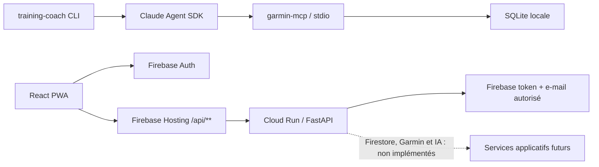

# Garmin Trainer — inventaire de l’état actuel

> **Type :** inventaire brownfield, sans décision d’architecture cible · **Public :** référence personnelle · **Mode :** Fast path
> **Base source :** dépôt au commit `7a37835` et état des opérations rapporté dans cette session

## Synthèse

Le dépôt contient deux générations du produit :

1. Une **CLI Python fonctionnelle** qui interroge les données Garmin locales par MCP et utilise Claude pour produire une réponse de coaching.
2. Une **fondation web/cloud** — PWA, API FastAPI, Firebase Auth et Terraform — limitée pour l’instant à la connexion et à un endpoint d’identité. La synchronisation Garmin, Firestore applicatif, coaching, chat et feedback ne sont pas encore implémentés dans cette voie.

La CLI existante continue de dépendre de `garmin-health-data` et d’une base SQLite locale. Le chemin web vise Firebase Hosting → Cloud Run, avec authentification Firebase vérifiée côté API.

## 1. CLI Python et accès Garmin MCP

| Élément | Fichier / dépendance | État constaté |
|---|---|---|
| Point d’entrée | `pyproject.toml` → `training-coach = agents.training_coach:main` | CLI installable ; question par défaut : `Plan my next 7 days.` |
| Agent | `agents/training_coach.py` | Un agent, prompt de coaching endurance, réponse streamée sur stdout, appels outils signalés sur stderr. |
| Modèle | `agents/training_coach.py` | `claude-opus-4-7` via Claude Agent SDK / Claude Code CLI. Le code retire `ANTHROPIC_API_KEY` et utilise l’authentification Claude CLI. |
| Transport Garmin | `agents/training_coach.py` | Lance `garmin-mcp` comme serveur MCP en stdio ; pas de requêtes SQL directes par cet agent. |
| Base source | `GARMIN_DB_PATH` | SQLite locale produite par le projet externe `garmin-health-data`; le chemin doit exister. Le package `garmin-health-data` n’est pas dans ce dépôt. |
| Outils exposés | `GARMIN_TOOLS` | 11 outils en lecture seule : profil, activités et détails, charge, readiness, sommeil, HRV, VO₂ max, records, prédictions et liste d’utilisateurs. |

La conversation CLI est one-shot : l’historique des échanges n’est pas persisté par ce code. Le prompt demande une réponse contextualisée et interdit de fabriquer des métriques.

## 2. PWA et API

| Élément | Fichier / technologie | État constaté |
|---|---|---|
| PWA | `web/` — React/TypeScript, Vite, Firebase JS SDK, `vite-plugin-pwa` | Écran de connexion/inscription et vérification d’e-mail ; pas encore d’écran de séance, de chat ou de feedback. |
| Authentification client | `web/src/App.tsx`, `web/src/firebase.ts` | Firebase email/password ; après vérification, le client demande un Firebase ID token et appelle `/api/v1/me`. La configuration Firebase est fournie par variables `VITE_FIREBASE_*`. |
| API | `api/app/main.py` — FastAPI | `GET /healthz` public et minimal ; `GET /api/v1/me` vérifie le Firebase ID token, exige un e-mail vérifié et applique `ALLOWED_USER_EMAIL`. Documentation OpenAPI désactivée. |
| CORS | `api/app/main.py` | Origines provenant de `CORS_ALLOWED_ORIGINS`; en local, localhost:5173 par défaut. En production, Firebase Hosting relaie `/api/**`. |
| Conteneur | `api/Dockerfile` | Python 3.13 slim, Uvicorn sur le port 8080, processus non-root (UID 10001). |
| Tests | `api/tests/test_main.py` | 7 tests pour health, authentification requise, e-mail vérifié/autorisé et rejet de jetons ou d’identités invalides. |

L’API ne contient actuellement ni client Garmin/MCP, ni lecture/écriture Firestore, ni service de coaching ou d’inférence IA. Le formulaire web ne teste que le chemin d’identité.

## 3. Infrastructure déclarée dans Terraform

### Bootstrap du state

`infra/bootstrap-state/` déclare le bucket GCS privé et versionné `<project-id>-tfstate`, en `europe-west1`, avec prévention d’accès public et rôles bucket/object pour le compte WIF. L’état de ce root est local et ignoré par Git ; le bucket a été créé lors du bootstrap précédent.

### Bootstrap des permissions WIF

`infra/bootstrap-iam/` utilise un préfixe GCS séparé et déclare des rôles de provisionnement pour `github-terraform` : Service Usage Admin, Firebase Admin, Identity Platform Admin, Datastore Owner, Secret Manager Admin, Service Account Admin, Artifact Registry Admin, Cloud Run Admin et Project IAM Admin.

Le compte ne peut pas s’accorder lui-même le premier `roles/resourcemanager.projectIamAdmin`. Il faut donc un bootstrap initial via IAM GCP avant que ce root puisse être appliqué par le pipeline. Les rôles Datastore Owner et Secret Manager Admin donnent au runner des capacités sur les données Firestore et les valeurs de secrets : c’est une identité de confiance élevée.

### Infrastructure principale

`infra/` est le root Terraform principal, avec backend GCS et providers Google/Google Beta `~> 6.0` (lock actuel : 6.50.0). Il déclare :

- activation des APIs Artifact Registry, Firebase, Identity Platform, Firestore, Cloud Run, Secret Manager, Service Usage, IAM, Cloud Resource Manager et Billing Budgets ;
- projet Firebase, web app, site Hosting, et configuration Firebase Auth email/password avec domaines autorisés ;
- Firestore Native `(default)` en `europe-west1`, protégé contre la suppression Terraform ;
- conteneurs de secrets Secret Manager `garmin-personal-api-key` et `llm-api-key`, répliqués en région. Terraform ne contient pas leurs versions/valeurs ;
- compte de service runtime, accès Firestore et accès aux deux secrets ;
- dépôt Docker Artifact Registry `garmin-trainer` ;
- service Cloud Run `garmin-trainer-api`, min instances 0/max 1, 1 CPU/512 MiB, initialement sur l’image publique `hello`. Le workflow de release possède le cycle de vie de l’image ;
- liaison `allUsers` invoker Cloud Run pour le proxy Hosting. Les routes applicatives restent protégées dans FastAPI par Firebase ID token et allowlist d’e-mail ;
- pool/provider WIF GitHub et service account importés depuis le bootstrap ; la configuration source resserre l’identité à `workflow_dispatch`, l’environnement `production`, `main` et deux fichiers workflow ;
- alerte mensuelle GCP facultative, 6 USD par défaut, notification seulement, non plafond de dépenses.

`infra/FIRESTORE_SCHEMA.md` décrit des collections prévues (profils, objectifs, activités, mesures quotidiennes, séances, feedbacks, conversations et mémoire coach). C’est un schéma de référence : les endpoints et dépôts Firestore correspondants ne sont pas encore implémentés. `web/firestore.rules` refuse tout accès direct depuis le navigateur.

## 4. CI/CD et flux

- `.github/workflows/terraform-checks.yml` exécute les tests API, le build PWA et `terraform fmt`/`validate`; aucun accès GCP n’est accordé à ce workflow.
- `.github/workflows/deploy.yml` est manuel (`workflow_dispatch`) sur `main` : configure le state, applique `infra/bootstrap-iam`, applique le root principal, construit/pousse l’image API, met à jour Cloud Run puis publie Hosting et les règles Firestore.
- Le pipeline a besoin de GitHub variables `GCP_PROJECT_ID`, `GCP_WIF_PROVIDER`, `GCP_TERRAFORM_SERVICE_ACCOUNT`, `GCP_BILLING_ACCOUNT_ID`, ainsi que du secret `ALLOWED_USER_EMAIL`. `GCP_REGION` et `GCP_MONTHLY_BUDGET_USD` ont des valeurs par défaut.

## 5. État opérationnel observé

- La clé Garmin Personal API a été testée sur l’endpoint d’échange : réponse HTTP 200 et jeton texte reçu puis jeté. Aucun endpoint de données Garmin n’a été appelé et aucun flux de données santé n’a été téléchargé.
- Un apply Terraform local antérieur a créé une partie des ressources : Cloud Run avec image `hello`, Firestore, Artifact Registry, conteneurs de secrets, compte runtime, certaines API et liaisons IAM/WIF.
- Un workflow GitHub récent s’est arrêté pendant l’authentification WIF à cause d’un nom de fournisseur contenant une barre oblique initiale en trop ; il n’a exécuté ni Terraform ni déploiement. La variable `GCP_WIF_PROVIDER` a ensuite été normalisée, mais aucun nouveau run n’a confirmé le succès.
- Lors de la dernière vérification, les variables GitHub requises (`GCP_PROJECT_ID`, `GCP_REGION`, `GCP_TERRAFORM_SERVICE_ACCOUNT`, `GCP_WIF_PROVIDER`, `GCP_BILLING_ACCOUNT_ID`) et le secret `ALLOWED_USER_EMAIL` étaient présents. L’utilisateur indique que le blocage Firebase a été résolu, que le compte WIF possède Project IAM Admin et que l’exception organisationnelle `allUsers` est autorisée ; aucun apply réussi n’a encore confirmé l’état final.
- L’inventaire ne lit ni `.env`, ni tfvars, ni état Terraform. L’état GCP courant n’a donc pas été revalidé dans ce document.

## 6. Ce qui n’est pas encore en place dans le chemin web

- Synchronisation Garmin Personal API ou autre connecteur ; le code web ne consomme pas encore les données du CLI/MCP.
- Persistance Firestore et implémentation des collections décrites dans le schéma.
- Objectifs, plan long terme, séance du jour, alternatives, feedback post-séance, historique chat ou mémoire coach.
- Adaptateur d’inférence IA dans l’API ; OpenCode Go n’est pas appelé par le produit web.
- Une règle de rétention TTL effective pour les données Firestore.

Ce document décrit l’existant et ses limites ; il ne choisit ni ne prescrit l’architecture des phases suivantes.
